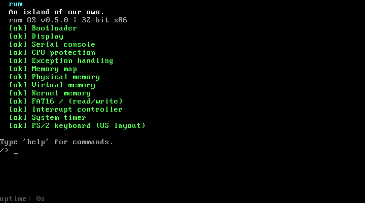
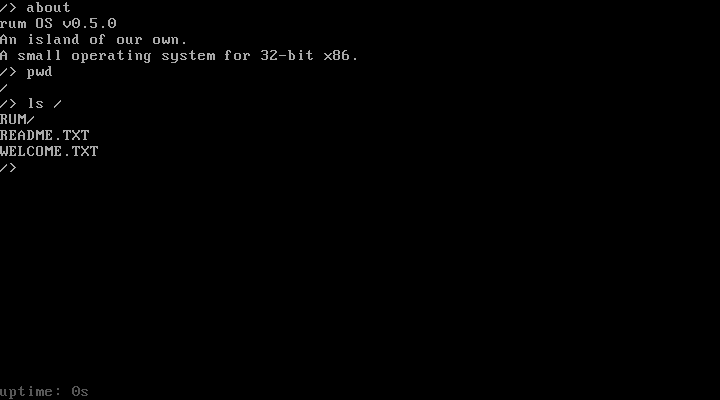
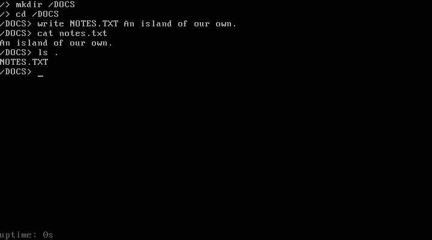
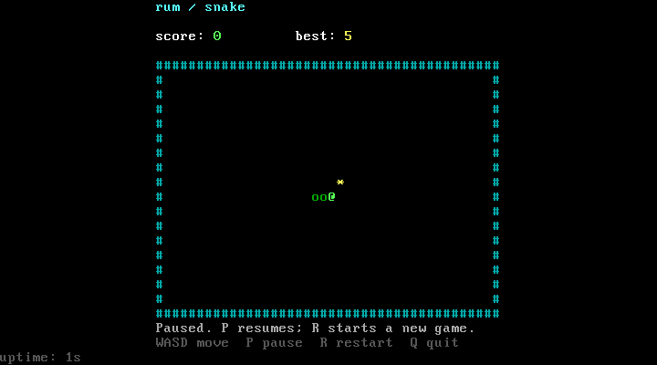

# rum

A small operating system written in C and x86 assembly, named after the
Scottish island of Rùm.

rum runs protected user programs on 32-bit x86 with BIOS firmware. It includes
a command shell, persistent FAT16 storage, preemptive multitasking and ASCII
Snake. QEMU, VMware Workstation and VirtualBox are supported.

## Getting started

Build in Ubuntu 24.04 or WSL 2. The PowerShell launcher uses Windows QEMU;
install it and add it to PATH. Run `.\rum.ps1 setup` once for build dependencies
and `.\rum.ps1 doctor` to check the environment.

```powershell
.\rum.ps1 build
.\rum.ps1 prepare-disk -DiskImage .\build\rum-system.raw
.\rum.ps1 run -DiskImage .\build\rum-system.raw
```

Linux/WSL:

```sh
make -j4
make prepare-disk DISK_IMAGE=build/rum-system.raw
make run DISK_IMAGE=build/rum-system.raw
```

Preparation only accepts a new path. It creates FAT16 and installs the shell
and commands in `/RUM`. Keep the ISO and disk attached: the ISO starts the
kernel; the disk supplies programs and files. Without a usable system disk,
rum opens its recovery console. Normal startup never formats an image.

See [setup](docs/setup.md), [system disk](docs/system-volume.md) and
[VMware/VirtualBox](docs/virtual-machines.md) for details.

## Using rum

Type `help` for commands. The prompt shows the working directory. Paths are
case-insensitive and names use 8.3 spelling. Files are saved on disk and survive
restarts. There is no RAM filesystem.

```text
ls /
mkdir /DOCS
cd /DOCS
write NOTES.TXT hello from rum
cat notes.txt
run hello
start spin
ps
kill <pid>
```

`recovery` enters the recovery console, where `mem`, `diag` and Snake remain
available even without usable storage. `exit` restarts the normal shell.
Wait for a command to finish before shutting down the VM. FAT16 has no journal;
an interrupted write may require host repair. See [filesystem behavior](docs/fat16.md).

## Screenshots

| Startup | Shell |
| --- | --- |
|  |  |
| **Files** | **Snake** |
|  |  |

## Build and test

| PowerShell | Linux/WSL | Purpose |
| --- | --- | --- |
| `.\rum.ps1 build` | `make -j4` | Build kernel, programs and ISO |
| `.\rum.ps1 user` | `make user` | Build system programs |
| `.\rum.ps1 run -DiskImage <image>` | `make run DISK_IMAGE=<image>` | Start with an existing raw disk |
| `.\rum.ps1 test` | `make test` | Run host and QEMU checks |
| `.\rum.ps1 debug -DiskImage <image>` | `make debug DISK_IMAGE=<image>` | Start paused with GDB on port 1234 |

`build/rum.elf` is the kernel and `build/rum.iso` is the boot/recovery image.
System programs are built in `build/user/system/`. Rebuilding programs does
not update existing disks. Use a new disk for a fresh installation, or back up
an existing image before deliberately replacing its `/RUM` files with host FAT
tools. Never run two VMs against the same writable disk.

## Packaging

`python3 scripts/package.py` creates `rum.zip` containing the ISO, this README
and documentation. The ISO alone provides recovery; normal startup also needs
a prepared system disk.

After building, run `python3 scripts/prepare-vm-images.py` in Ubuntu/WSL to create
a separate `rum-vm-images.zip` with a fresh installed system disk in raw, VMDK
and VDI formats, the ISO and a VMware preset. Existing output directories are
refused. [Release checks](docs/release.md) cover packaging and recovery.

## Source

| Directory | Contents |
| --- | --- |
| `arch/`, `boot/`, `hal/` | CPU setup, boot and platform code |
| `kernel/`, `drivers/` | Core services, memory, processes, FAT16 and hardware drivers |
| `sdk/` | Public ABI, runtime and example applications |
| `system/`, `apps/` | Shell, command programs and applications |
| `assets/disk/` | Initial disk documentation |
| `tests/`, `scripts/` | Regression tests, toolchain, build and packaging tools |

See the [documentation](docs/README.md), [source layout](docs/source-layout.md)
and [roadmap](docs/roadmap.md).
