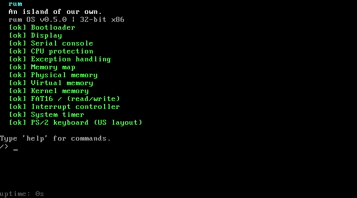
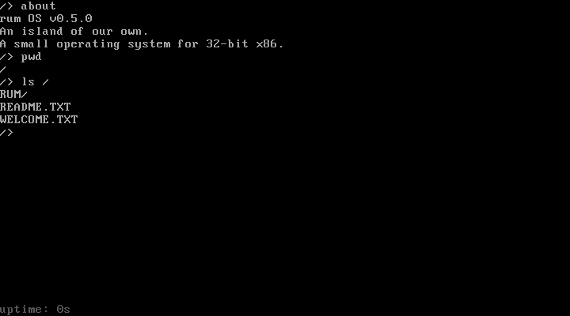
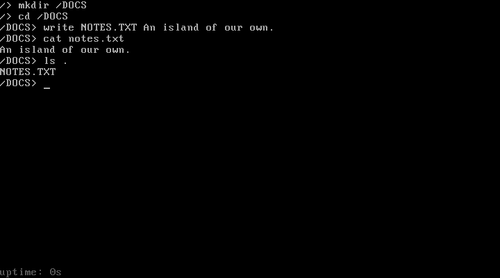
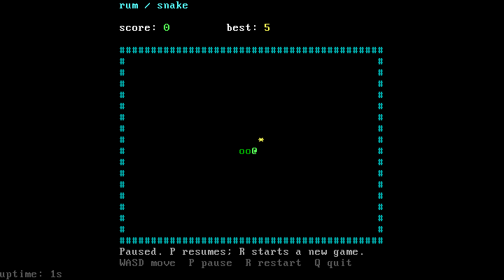

# rum

A small operating system written in C and x86 assembly, named after the
Scottish island of Rùm.

rum runs protected user programs on 32-bit x86 with BIOS firmware. It includes
a userspace shell with pipes, redirection and background jobs, persistent FAT16
storage, preemptive multitasking and ASCII Snake. Applications have private
memory, a growing heap and a small C runtime, with a standalone SDK for external
projects. QEMU, VMware Workstation and VirtualBox are supported.

## Getting started

Build in Ubuntu 24.04 or WSL 2. The PowerShell launcher uses Windows QEMU;
install it and add it to PATH. Run `.\rum.ps1 setup` once for build dependencies
and `.\rum.ps1 doctor` to check the environment.

```powershell
.\rum.ps1 build
.\rum.ps1 prepare-disk -DiskImage .\build\rum-system.raw
.\rum.ps1 run -DiskImage .\build\rum-system.raw
```

Linux/WSL:

```sh
./rum build -j4
./rum prepare-disk --disk build/rum-system.raw
./rum run --disk build/rum-system.raw
```

Preparation only accepts a new path. It creates FAT16 and installs the shell
and commands in `/RUM`. Keep the ISO and disk attached: the ISO starts the
kernel; the disk supplies programs and files. Without a usable system disk,
rum opens its recovery console. Normal startup never formats an image.

See [setup](docs/setup.md), [system disk](docs/system-volume.md) and
[VMware/VirtualBox](docs/virtual-machines.md) for details.

To build applications outside this repository, export the
[standalone SDK](docs/sdk.md) with `.\rum.ps1 sdk` or `./rum sdk`.

## Using rum

Type `help` for a paged command guide, or `help --all` for plain output.
`more`, `head`, `wc` and `hexdump` provide text and binary inspection.
The colored prompt shows the working directory. Paths are
case-insensitive and names use 8.3 spelling. Files are saved on disk and survive
restarts. There is no RAM filesystem.

```text
setup
cd /HOME
echo 'hello from rum' | cat > NOTES.TXT
echo 'another line' >> NOTES.TXT
cp NOTES.TXT BACKUP.TXT
cat BACKUP.TXT
sleep 2000 &
jobs
wait
sync
run hello
```

Arrow keys, Home/End and Delete edit the command; Up/Down browse history and
Tab completes names. Page Up/Page Down browse output. Ctrl+L clears the screen
while preserving the draft, and Ctrl+U clears the draft. See the
[shell guide](docs/shell.md), [jobs](docs/jobs.md) and
[file tools](docs/file-tools.md) for syntax, limits and application installation.

`recovery` enters the recovery console, where `mem`, `diag` and Snake remain
available even without usable storage. `exit` restarts the normal shell.
`handles` shows the command's own resource counts. Use `shutdown` or `reboot`
to flush storage and stop or restart rum. FAT16 has no journal;
an interrupted write may require host repair. See [filesystem behavior](docs/fat16.md).

## Screenshots

| Startup | Shell |
| --- | --- |
|  |  |
| **Files** | **Snake** |
|  |  |

## Build and test

| PowerShell | Linux/WSL | Purpose |
| --- | --- | --- |
| `.\rum.ps1 build -Jobs 4` | `./rum build -j4` | Build kernel, programs and ISO |
| `.\rum.ps1 user` | `./rum user` | Build system programs |
| `.\rum.ps1 run -DiskImage <image>` | `./rum run --disk <image>` | Start with an existing raw disk |
| `.\rum.ps1 test -Workers 4` | `./rum test --workers 4` | Run host and QEMU checks |
| `.\rum.ps1 debug -DiskImage <image>` | `./rum debug --disk <image>` | Start paused with GDB on port 1234 |
| `.\rum.ps1 package` | `./rum package` | Build and package ISO, README and docs |
| `.\rum.ps1 clean` | `./rum clean` | Remove compiler outputs; preserve disks and VM bundles |

`build/rum.elf` is the kernel and `build/rum.iso` is the boot/recovery image.
System programs are built in `build/user/system/`. Rebuilding programs does
not update existing disks. Use a new disk for a fresh installation, or back up
an existing image before deliberately replacing its `/RUM` files with host FAT
tools. Never run two VMs against the same writable disk.

Both launchers share `scripts/rum.py`; Windows uses WSL's Python and build
tools. Build jobs and test workers default to four. Use `-Suite host` /
`--suite host` for host checks or `-DryRun` / `--dry-run` to preview commands.
The underlying Make targets remain available. See [setup](docs/setup.md) and
[testing](docs/testing.md) for options, coverage and reports.

## Packaging

`package` creates `rum.zip` containing the ISO, this README
and documentation. The ISO alone provides recovery; normal startup also needs
a prepared system disk.

Run `.\rum.ps1 vm-images` or `./rum vm-images` to build and create
a separate `rum-vm-images.zip` with a fresh installed system disk in raw, VMDK
and VDI formats, the ISO and a VMware preset. Existing output directories are
refused. [Release checks](docs/release.md) cover packaging and recovery.

## Source

| Directory | Contents |
| --- | --- |
| `arch/`, `boot/`, `hal/` | CPU setup, boot and platform code |
| `kernel/`, `drivers/` | Core services, memory, processes, FAT16 and hardware drivers |
| `sdk/` | Public ABI, runtime and example applications |
| `system/`, `apps/` | Shell, command programs and applications |
| `assets/disk/` | Initial disk documentation |
| `tests/`, `scripts/` | Regression tests, toolchain, build and packaging tools |
| `mk/` | Configuration, kernel, userspace, test and workflow Make rules |

See the [documentation](docs/README.md), [source layout](docs/source-layout.md)
and [roadmap](docs/roadmap.md).
